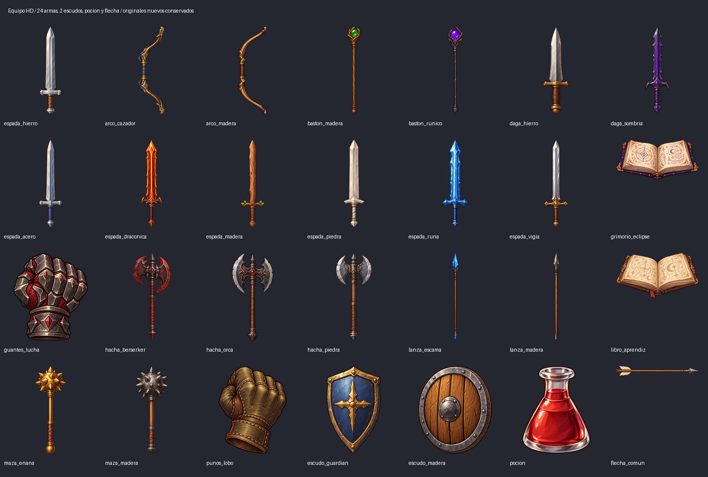

# Equipo HD compartido

Novato, Mago, Espadachín, Acólito y Arquero usan las mismas capas por sexo. Cada comparativa sigue este orden de clases. Cuatro fases por acción.

**56 hojas compartidas, 1104 fotogramas de equipo.** Celdas de 384×384; el cuerpo de 128×256 conserva su escala y se coloca en (128,64). Las filas incompatibles con un objeto son transparentes. El juego sigue pendiente de integración.

Abre `galeria.html` en un navegador para elegir objeto, sexo y acción, detener la animación, ampliar o reflejar la imagen. Las previews son composiciones para revisión; las capas reutilizables están en las carpetas de cada objeto.

| Objeto | Contacto masculino | Animación masculina | Contacto femenino | Animación femenina |
|---|---|---|---|---|
| espada_hierro | [PNG](espada_hierro/m/attack_sword.png) | [GIF](espada_hierro/m/attack_sword.gif) | [PNG](espada_hierro/f/attack_sword.png) | [GIF](espada_hierro/f/attack_sword.gif) |
| arco_cazador | [PNG](arco_cazador/m/attack_bow.png) | [GIF](arco_cazador/m/attack_bow.gif) | [PNG](arco_cazador/f/attack_bow.png) | [GIF](arco_cazador/f/attack_bow.gif) |
| arco_madera | [PNG](arco_madera/m/attack_bow.png) | [GIF](arco_madera/m/attack_bow.gif) | [PNG](arco_madera/f/attack_bow.png) | [GIF](arco_madera/f/attack_bow.gif) |
| baston_madera | [PNG](baston_madera/m/attack_staff.png) | [GIF](baston_madera/m/attack_staff.gif) | [PNG](baston_madera/f/attack_staff.png) | [GIF](baston_madera/f/attack_staff.gif) |
| baston_runico | [PNG](baston_runico/m/attack_staff.png) | [GIF](baston_runico/m/attack_staff.gif) | [PNG](baston_runico/f/attack_staff.png) | [GIF](baston_runico/f/attack_staff.gif) |
| daga_hierro | [PNG](daga_hierro/m/attack_dagger.png) | [GIF](daga_hierro/m/attack_dagger.gif) | [PNG](daga_hierro/f/attack_dagger.png) | [GIF](daga_hierro/f/attack_dagger.gif) |
| daga_sombria | [PNG](daga_sombria/m/attack_dagger.png) | [GIF](daga_sombria/m/attack_dagger.gif) | [PNG](daga_sombria/f/attack_dagger.png) | [GIF](daga_sombria/f/attack_dagger.gif) |
| espada_acero | [PNG](espada_acero/m/attack_sword.png) | [GIF](espada_acero/m/attack_sword.gif) | [PNG](espada_acero/f/attack_sword.png) | [GIF](espada_acero/f/attack_sword.gif) |
| espada_draconica | [PNG](espada_draconica/m/attack_sword.png) | [GIF](espada_draconica/m/attack_sword.gif) | [PNG](espada_draconica/f/attack_sword.png) | [GIF](espada_draconica/f/attack_sword.gif) |
| espada_madera | [PNG](espada_madera/m/attack_sword.png) | [GIF](espada_madera/m/attack_sword.gif) | [PNG](espada_madera/f/attack_sword.png) | [GIF](espada_madera/f/attack_sword.gif) |
| espada_piedra | [PNG](espada_piedra/m/attack_sword.png) | [GIF](espada_piedra/m/attack_sword.gif) | [PNG](espada_piedra/f/attack_sword.png) | [GIF](espada_piedra/f/attack_sword.gif) |
| espada_runa | [PNG](espada_runa/m/attack_sword.png) | [GIF](espada_runa/m/attack_sword.gif) | [PNG](espada_runa/f/attack_sword.png) | [GIF](espada_runa/f/attack_sword.gif) |
| espada_vigia | [PNG](espada_vigia/m/attack_sword.png) | [GIF](espada_vigia/m/attack_sword.gif) | [PNG](espada_vigia/f/attack_sword.png) | [GIF](espada_vigia/f/attack_sword.gif) |
| grimorio_eclipse | [PNG](grimorio_eclipse/m/attack_book.png) | [GIF](grimorio_eclipse/m/attack_book.gif) | [PNG](grimorio_eclipse/f/attack_book.png) | [GIF](grimorio_eclipse/f/attack_book.gif) |
| guantes_lucha | [PNG](guantes_lucha/m/attack_gloves.png) | [GIF](guantes_lucha/m/attack_gloves.gif) | [PNG](guantes_lucha/f/attack_gloves.png) | [GIF](guantes_lucha/f/attack_gloves.gif) |
| hacha_berserker | [PNG](hacha_berserker/m/attack_axe.png) | [GIF](hacha_berserker/m/attack_axe.gif) | [PNG](hacha_berserker/f/attack_axe.png) | [GIF](hacha_berserker/f/attack_axe.gif) |
| hacha_orca | [PNG](hacha_orca/m/attack_axe.png) | [GIF](hacha_orca/m/attack_axe.gif) | [PNG](hacha_orca/f/attack_axe.png) | [GIF](hacha_orca/f/attack_axe.gif) |
| hacha_piedra | [PNG](hacha_piedra/m/attack_axe.png) | [GIF](hacha_piedra/m/attack_axe.gif) | [PNG](hacha_piedra/f/attack_axe.png) | [GIF](hacha_piedra/f/attack_axe.gif) |
| lanza_escama | [PNG](lanza_escama/m/attack_spear.png) | [GIF](lanza_escama/m/attack_spear.gif) | [PNG](lanza_escama/f/attack_spear.png) | [GIF](lanza_escama/f/attack_spear.gif) |
| lanza_madera | [PNG](lanza_madera/m/attack_spear.png) | [GIF](lanza_madera/m/attack_spear.gif) | [PNG](lanza_madera/f/attack_spear.png) | [GIF](lanza_madera/f/attack_spear.gif) |
| libro_aprendiz | [PNG](libro_aprendiz/m/attack_book.png) | [GIF](libro_aprendiz/m/attack_book.gif) | [PNG](libro_aprendiz/f/attack_book.png) | [GIF](libro_aprendiz/f/attack_book.gif) |
| maza_enana | [PNG](maza_enana/m/attack_mace.png) | [GIF](maza_enana/m/attack_mace.gif) | [PNG](maza_enana/f/attack_mace.png) | [GIF](maza_enana/f/attack_mace.gif) |
| maza_madera | [PNG](maza_madera/m/attack_mace.png) | [GIF](maza_madera/m/attack_mace.gif) | [PNG](maza_madera/f/attack_mace.png) | [GIF](maza_madera/f/attack_mace.gif) |
| punos_lobo | [PNG](punos_lobo/m/attack_gloves.png) | [GIF](punos_lobo/m/attack_gloves.gif) | [PNG](punos_lobo/f/attack_gloves.png) | [GIF](punos_lobo/f/attack_gloves.gif) |
| escudo_guardian | [PNG](escudo_guardian/m/block_shield.png) | [GIF](escudo_guardian/m/block_shield.gif) | [PNG](escudo_guardian/f/block_shield.png) | [GIF](escudo_guardian/f/block_shield.gif) |
| escudo_madera | [PNG](escudo_madera/m/block_shield.png) | [GIF](escudo_madera/m/block_shield.gif) | [PNG](escudo_madera/f/block_shield.png) | [GIF](escudo_madera/f/block_shield.gif) |
| pocion | [PNG](pocion/m/use_consumable.png) | [GIF](pocion/m/use_consumable.gif) | [PNG](pocion/f/use_consumable.png) | [GIF](pocion/f/use_consumable.gif) |
| flecha_comun | [PNG](flecha_comun/m/attack_bow.png) | [GIF](flecha_comun/m/attack_bow.gif) | [PNG](flecha_comun/f/attack_bow.png) | [GIF](flecha_comun/f/attack_bow.gif) |
