# Nuevas clases y progresión

El catálogo contiene 61 clases, de las cuales 27 son nuevas. No se añaden clases Tier 1.5; Super Novato conserva su definición y requisitos.

## Acceso y máximos Job

| Tier | Job en cada requisito | Job máximo |
|---|---:|---:|
| 0 | Inicial | 20 |
| 1 | Novato 10 | 40 |
| 1.5 | Requisitos originales de Super Novato | 80 |
| 2 | 20 | 60 |
| 2.5 | 20 | 70 |
| 3 | 30 | 80 |
| 3.5 | 30 | 80 |

Comerciante es la excepción de acceso: Novato Job 10, cualquiera de las cuatro troncales a Job 20 y cinco intercambios comerciales completados. Los intercambios se consultan en AfinidadComercial del propio jugador. No requiere migración ni reinicia progresos existentes. Los requisitos se validan de nuevo en el servidor dentro de una transacción.

## Dominio y combate

- El dominio de armas y escudos se hereda de todos los antecesores; el bono aplicado es el de la clase activa y no suma bonos de generaciones anteriores. Las armaduras mantienen los dominios propios de cada clase.
- Cada incorporación dispone de tres activas y dos pasivas, aprendibles a Job 1/15/30 y 25/40 respectivamente. Se conservan las habilidades heredadas y el gasto de puntos de su profesión propietaria.
- Hoja del velo conserva Espadachín rúnico como requisito, junto a Maestro de espadas. Sus técnicas propias escalan con ataque físico y se mitigan con defensa mágica, incluidos sus pulsos.
- Abjurador aplica una barrera de una carga durante dos turnos. Bloquea un ataque directo, impide el drenaje y los perjuicios de ese impacto y se consume. Los fallos y el daño periódico no gastan la barrera. Mejorar la habilidad no añade cargas.
- Bardo mejora precisión/evasión y cura progresivamente; Heraldo mejora ataque/defensa y ataque mágico del grupo. Reaplicar una habilidad renueva sus efectos sin acumular su defensa.
- Las habilidades de fila y área usan el selector de formación compartido; el apoyo de grupo se aplica a los aliados vivos.

## Comerciante y oficios

- Comerciante y sus descendientes Alquimista/Herrero permanecen ocultos en el árbol hasta descubrir el oficio. Una vez desbloqueado, el descubrimiento se conserva.
- Comerciante multiplica la probabilidad de botín de enemigos por 1,20, con límite del 100 %. No cambia la tabla de rarezas ni permite botín donde la probabilidad base es cero.
- Obtiene un 10 % adicional de oro al resolver rutas comerciales. El cálculo usa la profesión activa, no la etiqueta legacy del personaje, y no duplica el antiguo bono de Comerciante/Mercader.
- Alquimista y Herrero heredan ambas ventajas comerciales sin multiplicarlas de nuevo. Sus técnicas de combate ya están disponibles.
- La transformación de objetos del Alquimista y la fabricación del Herrero quedan para una entrega posterior. No se añaden recetas ni endpoints vacíos.
- A partir de esta versión solo las rutas comerciales exitosas incrementan intercambios y afinidad y pagan la participación al destinatario.

## Presentación

El árbol distribuye automáticamente todas las clases descubiertas por tier, incluidos Super Novato y Tier 3.5. El ancho crece con el catálogo, con desplazamiento horizontal. Las clases nuevas reutilizan provisionalmente el arte de un antecesor; Comerciante aprovecha su arte legacy. Los nombres y las identidades jugables se mantienen.

## Grafo completo

★ identifica incorporaciones. Todas las aristas entrantes son requisitos conjuntos; la condición adicional transversal de Comerciante se describe arriba. Corsario evoluciona directamente de Pirata sin una segunda mezcla.

```mermaid
flowchart TB
  subgraph tier_0["Tier 0"]
    novato["Novato"]
  end
  subgraph tier_1["Tier 1"]
    espadachin["Espadachín"]
    acolito["Acólito"]
    arquero["Arquero"]
    mago["Mago"]
  end
  subgraph tier_1_5["Tier 1.5"]
    superNovato["Super Novato"]
  end
  subgraph tier_2["Tier 2"]
    caballero["Caballero"]
    duelista["Duelista"]
    sacerdote["Sacerdote"]
    monje["Monje"]
    cazador["Cazador"]
    explorador["Explorador"]
    elementalista["Elementalista"]
    brujo["Brujo"]
    berserker["★ Berserker"]
    luchador["★ Luchador"]
    centinela["★ Centinela"]
    escriba_arcano["★ Escriba arcano"]
    bardo["★ Bardo"]
    comerciante["★ Comerciante"]
  end
  subgraph tier_2_5["Tier 2.5"]
    cruzado["Cruzado"]
    pirata["Pirata"]
    druida["Druida"]
    espadachin_runico["Espadachín rúnico"]
    chaman["★ Chamán"]
    inquisidor["★ Inquisidor"]
    heraldo_guerra["★ Heraldo de guerra"]
    ninja["★ Ninja"]
    alquimista["★ Alquimista"]
    herrero["★ Herrero"]
  end
  subgraph tier_3["Tier 3"]
    paladin["Paladín"]
    guardian_real["Guardián real"]
    asesino["Asesino"]
    maestro_espadas["Maestro de espadas"]
    oraculo["Oráculo"]
    hierofante["Hierofante"]
    asceta["Asceta"]
    gran_maestro["Gran maestro"]
    francotirador["Francotirador"]
    domabestias["Domabestias"]
    guardian_bosque["Guardián del bosque"]
    rastreador["Rastreador"]
    archimago["Archimago"]
    invocador["Invocador"]
    nigromante["Nigromante"]
    demonologo["Demonólogo"]
    verdugo["★ Verdugo"]
    saqueador["★ Saqueador"]
    campeon_arena["★ Campeón de arena"]
    mariscal["★ Mariscal"]
    vigia["★ Vigía"]
    runista["★ Runista"]
    abjurador["★ Abjurador"]
  end
  subgraph tier_3_5["Tier 3.5"]
    senor_guerra["★ Señor de la guerra"]
    avatar_tormenta["★ Avatar de la tormenta"]
    cazador_espectral["★ Cazador espectral"]
    arconte["★ Arconte"]
    justiciero["★ Justiciero"]
    hoja_velo["★ Hoja del velo"]
    danzaespadas["★ Danzaespadas"]
    corsario["★ Corsario"]
  end
  novato -->|"Job 10"| espadachin
  novato -->|"Job 10"| acolito
  novato -->|"Job 10"| arquero
  novato -->|"Job 10"| mago
  novato -->|"Job 20"| superNovato
  espadachin -->|"Job 20"| superNovato
  acolito -->|"Job 20"| superNovato
  arquero -->|"Job 20"| superNovato
  mago -->|"Job 20"| superNovato
  espadachin -->|"Job 20"| caballero
  espadachin -->|"Job 20"| duelista
  acolito -->|"Job 20"| sacerdote
  acolito -->|"Job 20"| monje
  arquero -->|"Job 20"| cazador
  arquero -->|"Job 20"| explorador
  mago -->|"Job 20"| elementalista
  mago -->|"Job 20"| brujo
  caballero -->|"Job 20"| cruzado
  sacerdote -->|"Job 20"| cruzado
  duelista -->|"Job 20"| pirata
  cazador -->|"Job 20"| pirata
  explorador -->|"Job 20"| druida
  elementalista -->|"Job 20"| druida
  duelista -->|"Job 20"| espadachin_runico
  brujo -->|"Job 20"| espadachin_runico
  caballero -->|"Job 30"| paladin
  caballero -->|"Job 30"| guardian_real
  duelista -->|"Job 30"| asesino
  duelista -->|"Job 30"| maestro_espadas
  sacerdote -->|"Job 30"| oraculo
  sacerdote -->|"Job 30"| hierofante
  monje -->|"Job 30"| asceta
  monje -->|"Job 30"| gran_maestro
  cazador -->|"Job 30"| francotirador
  cazador -->|"Job 30"| domabestias
  explorador -->|"Job 30"| guardian_bosque
  explorador -->|"Job 30"| rastreador
  elementalista -->|"Job 30"| archimago
  elementalista -->|"Job 30"| invocador
  brujo -->|"Job 30"| nigromante
  brujo -->|"Job 30"| demonologo
  espadachin -->|"Job 20"| berserker
  acolito -->|"Job 20"| luchador
  arquero -->|"Job 20"| centinela
  mago -->|"Job 20"| escriba_arcano
  arquero -->|"Job 20"| bardo
  novato -->|"Job 10"| comerciante
  berserker -->|"Job 20"| chaman
  elementalista -->|"Job 20"| chaman
  sacerdote -->|"Job 20"| inquisidor
  brujo -->|"Job 20"| inquisidor
  luchador -->|"Job 20"| heraldo_guerra
  escriba_arcano -->|"Job 20"| heraldo_guerra
  bardo -->|"Job 20"| ninja
  explorador -->|"Job 20"| ninja
  mago -->|"Job 20"| ninja
  comerciante -->|"Job 20"| alquimista
  mago -->|"Job 20"| alquimista
  comerciante -->|"Job 20"| herrero
  espadachin -->|"Job 20"| herrero
  berserker -->|"Job 30"| verdugo
  berserker -->|"Job 30"| saqueador
  luchador -->|"Job 30"| campeon_arena
  centinela -->|"Job 30"| mariscal
  centinela -->|"Job 30"| vigia
  escriba_arcano -->|"Job 30"| runista
  escriba_arcano -->|"Job 30"| abjurador
  verdugo -->|"Job 30"| senor_guerra
  mariscal -->|"Job 30"| senor_guerra
  gran_maestro -->|"Job 30"| avatar_tormenta
  archimago -->|"Job 30"| avatar_tormenta
  francotirador -->|"Job 30"| cazador_espectral
  nigromante -->|"Job 30"| cazador_espectral
  hierofante -->|"Job 30"| arconte
  archimago -->|"Job 30"| arconte
  paladin -->|"Job 30"| justiciero
  campeon_arena -->|"Job 30"| justiciero
  espadachin_runico -->|"Job 30"| hoja_velo
  maestro_espadas -->|"Job 30"| hoja_velo
  bardo -->|"Job 30"| danzaespadas
  maestro_espadas -->|"Job 30"| danzaespadas
  pirata -->|"Job 30"| corsario
```

## Validación

Las pruebas cubren requisitos y máximos, grafo sin ciclos, herencia de habilidades y dominio, cobertura de armas, descubrimiento y validación API, bonificaciones comerciales, daño mágico con escalado físico, barreras y renovación del apoyo en party. Los sprites provisionales se comprueban contra archivos reales.
